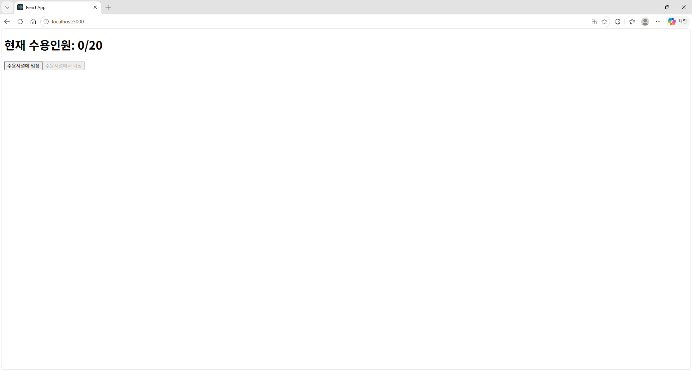
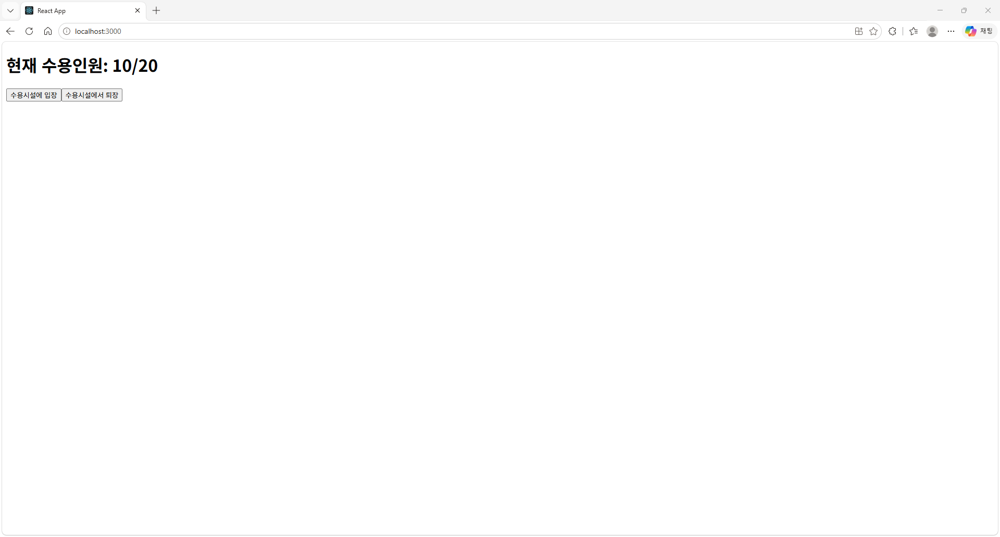
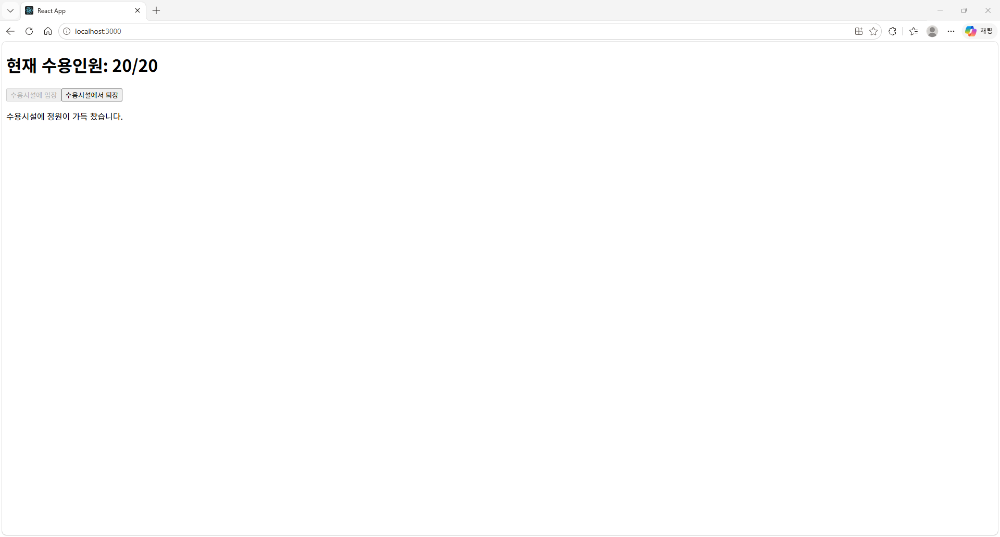

# Custom Hook(사용자 정의 훅)을 사용하여 상태 관리

## 구현할 내용
- 위에 표시된 첫 화면과 같이 `현재 수용인원: N/N`과 `수용시설에 입장`, `수용시설에서 퇴장` 버튼을 만들어라. 이때, 현재 수용인원이 0명이면 `수용시설에서 퇴장` 버튼이 비활성화 되어야한다. 
- 
- 위에 표시된 두 번째 화면은 `수용시설에 입장` 버튼을 10번 눌러 현재 수용인원을 10명으로 늘린 사진이다.
- 
- 위에 표시된 세 번째 화면은 `수용시설에 입장` 버튼을 20번 눌러 현재 수용인원을 20명으로 늘린 사진이다. 이때, 현재 수용인원이 20명으로 최대 수용인원에 다다랐으면 "수용시설에 인원이 가득 찼습니다"라는 문구가 떠야한다.

## 제약사항
- `withCustomHook` 폴더에는 Custom Hook(사용자 정의 훅)을 이용해 구현한 코드를, `withoutCustomHook` 폴더에는 Custom Hook(사용자 정의 훅)을 이용하지 않고 구현한 코드를 작성해라.